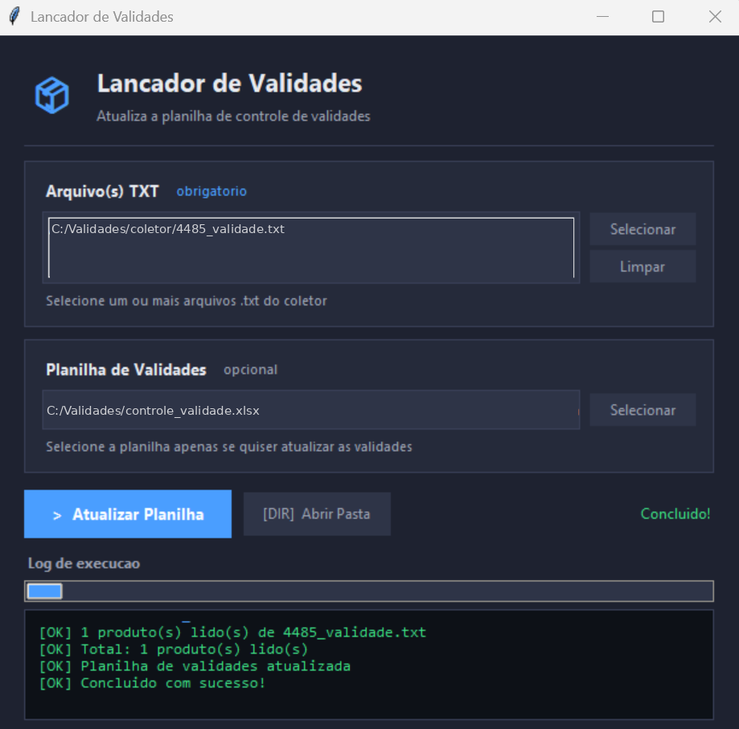
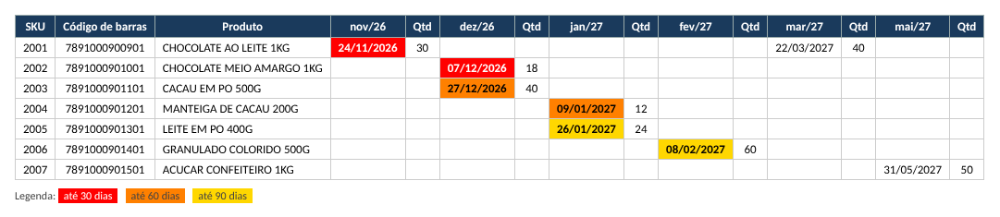
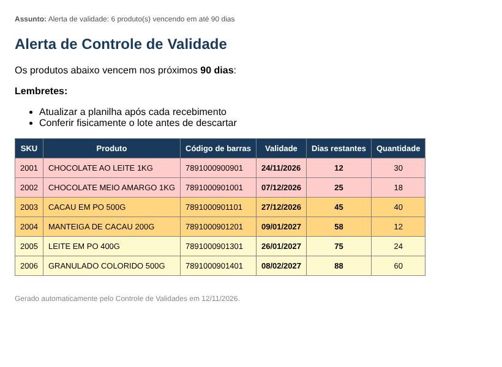

# 📦 Controle de Validade, Lançador e Alerta por E-mail

> Automação em Python para o controle de validade de produtos no varejo. Um aplicativo de desktop lê os arquivos exportados pelo coletor de inventário e alimenta a planilha de validades; um segundo script roda todo dia, identifica os lotes próximos do vencimento e envia um alerta por e-mail para as áreas de estoque e compras.

[](https://www.python.org)
[](https://openpyxl.readthedocs.io)
[](https://docs.python.org/3/library/tkinter.html)
[](#)

> ⚖️ **Uso do código.** Este projeto foi desenvolvido no contexto profissional do autor e é publicado, em versão sanitizada e com dados fictícios, exclusivamente para fins de portfólio. Todos os direitos reservados. Não é permitido o uso comercial sem autorização.

---

## 🎯 O problema

Produtos com validade chegavam ao estoque e eram registrados em planilha manualmente, lote por lote. Com cerca de mil itens monitorados, o controle falhava: ninguém conferia a planilha todo dia e produtos venciam na prateleira. A solução automatizou as duas pontas, a entrada dos dados e o aviso de vencimento.

## ⚙️ Como funciona

```
Coletor (EstoqueMax) ──► arquivo .txt ──► Lançador de Validades ──► controle_validade.xlsx
                                                                            │
                                   Agendador de Tarefas (diário) ──► alerta_validade.py ──► e-mail HTML
```

### 1. Lançador de Validades (`lancador_validades.py`)

Aplicativo de desktop em tkinter que lê um ou mais arquivos `.txt` no formato `SKU|CÓDIGO DE BARRAS|NOME|VALIDADE|QUANTIDADE` e atualiza a planilha seguindo regras de lote:

| Situação | O que acontece |
|---|---|
| Produto novo | Inserido na próxima linha livre. Sem SKU no arquivo, uma fórmula `VLOOKUP` busca o SKU na aba Produtos pelo código de barras |
| Produto existente, mês livre | Data e quantidade entram na coluna do mês, com comentário de recebimento na célula |
| Produto existente, mesmo mês já preenchido | Mantém a data mais antiga, soma as quantidades e acumula o histórico no comentário |
| Mesmo produto, meses diferentes | Cada validade vai para a coluna do seu mês, na mesma linha |
| Produto sem validade | Ignorado |

A planilha tem colunas fixas (SKU, código de barras, produto) seguidas de pares de colunas por mês (data | quantidade). Ao final, o script reaplica a formatação condicional: amarelo até 90 dias, laranja até 60, vermelho até 30.

### 2. Alerta de validade (`alerta_validade.py`)

Script sem interface, executado todo dia pelo Agendador de Tarefas do Windows. Lê a planilha, lista os lotes que vencem nos próximos N dias (padrão 90), ordena do mais urgente para o menos urgente e envia um e-mail em HTML com a tabela colorida no mesmo critério da planilha. Se não houver nada vencendo, não envia nada.

Toda a configuração (planilha, remetente, destinatários, dias de alerta, lembretes) vem de variáveis de ambiente ou de um arquivo `.env`, nunca do código.

## ✨ O que o projeto demonstra

- Manipulação avançada de Excel com openpyxl: células mescladas, comentários, formatação condicional por fórmula, fórmulas geradas dinamicamente
- Interface gráfica em tkinter com processamento em thread separada, log em tempo real e barra de progresso
- Regras de negócio de controle de lote (consolidação por mês, preservação da data mais antiga, histórico)
- Envio de e-mail HTML via SMTP com SSL, agendado sem usuário logado
- Separação entre código e configuração (`.env`), com instalador em `.bat` para usuários não técnicos
- Documentação de uso para a operação (`docs/`)

## 📸 Como fica

Lançador de Validades, aplicativo de desktop usado pela operação para alimentar a planilha a partir dos arquivos do coletor:



Planilha de controle com a formatação por urgência (amarelo até 90 dias, laranja até 60, vermelho até 30):



E-mail diário de alerta, ordenado do mais urgente para o menos urgente:



## 🚀 Como executar

> ⚠️ **Os arquivos deste repositório são exemplos.** A planilha, o arquivo do coletor, os e-mails e os lembretes são fictícios. Para usar de verdade, é preciso preencher o `.env` com os seus dados (remetente, senha de aplicativo, destinatários, pastas) e usar a sua própria planilha de controle, no mesmo formato da planilha de exemplo. O programa não funciona só com os arquivos baixados.

Requisitos: Windows com Python 3.10+.

1. Execute `INSTALAR.bat` (instala `openpyxl` e `python-dotenv` e cria o `EXECUTAR.bat`).
2. Copie `.env.exemplo` para `.env` e preencha remetente, senha de aplicativo e destinatários.
3. Abra o Lançador com `EXECUTAR.bat`, selecione o `.txt` do coletor e a planilha.
4. Agende `rodar_alerta.bat` no Agendador de Tarefas (diário, "executar mesmo sem usuário logado").

Para testar sem o coletor, use `exemplos/coletor_exemplo.txt` e `exemplos/controle_validade_exemplo.xlsx`.

## 📁 Estrutura

```
├── lancador_validades.py   Aplicativo de desktop que alimenta a planilha
├── alerta_validade.py      Alerta diário por e-mail
├── rodar_alerta.bat        Atalho para o Agendador de Tarefas
├── INSTALAR.bat            Instala dependências e cria o EXECUTAR.bat
├── .env.exemplo            Modelo de configuração
├── docs/                   Manual de utilização
└── exemplos/               Planilha e arquivo do coletor com dados fictícios
```

---

## 👤 Autor

**Heberth Augusto**

[](https://www.linkedin.com/in/heberth-augusto-ti/)
[](https://github.com/heberthaugusto)

*Desenvolvido com IA generativa (Claude) como ferramenta de trabalho, com definição das regras, revisão do código e validação em uso real pelo autor.*
