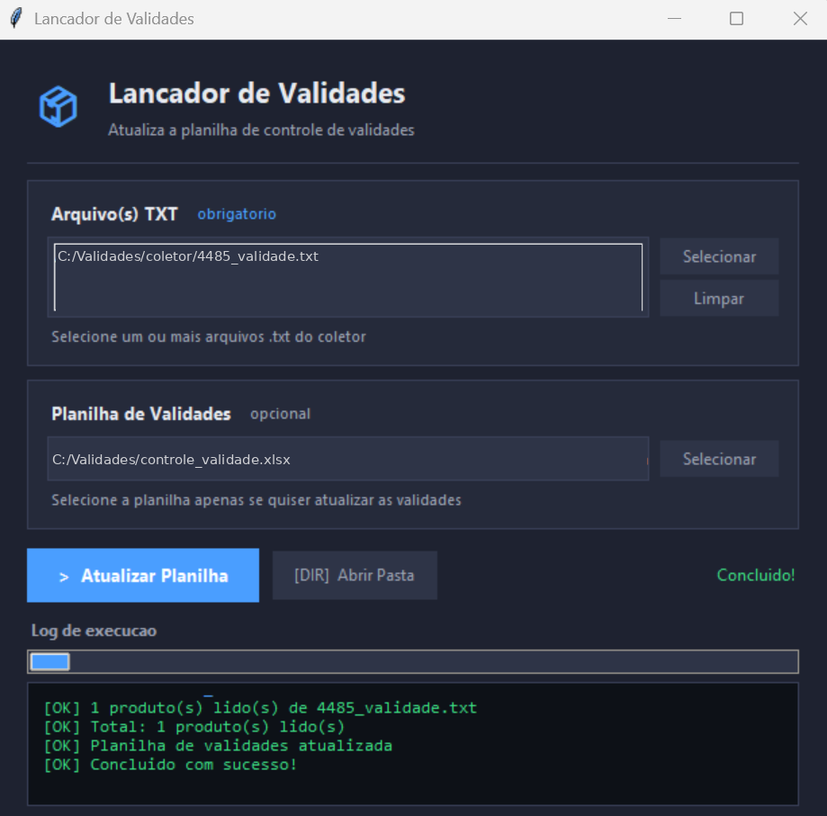

# Lançador de Validades, manual de utilização

## 1. Instalação

**Passo 1. Instalar o Python** (somente se não estiver instalado). Acesse python.org/downloads e baixe a versão mais recente para Windows. Durante a instalação, marque obrigatoriamente a opção "Add Python to PATH" antes de clicar em Install. Após instalar, reinicie o computador.

**Passo 2. Instalar as dependências.** Execute o arquivo `INSTALAR.bat`. Ele instala os pacotes necessários e cria o atalho `EXECUTAR.bat`. Este passo só precisa ser feito uma vez.

## 2. Como usar o programa

O Lançador lê os arquivos exportados pelo aplicativo de inventário e alimenta a planilha de controle de validades. O formato do arquivo de entrada é:

```
SKU | CÓDIGO DE BARRAS | NOME DO PRODUTO | VALIDADE | QUANTIDADE
Exemplo: 1001|7891000100103|LEITE CONDENSADO 395G|15-01-27|48
```

1. **Abra o programa.** Clique duas vezes em `EXECUTAR.bat`.
2. **Selecione o(s) arquivo(s) TXT.** Clique em Selecionar ao lado do campo "Arquivo(s) TXT". A janela abre na pasta configurada em `VALIDADE_PASTA_TXT`. Você pode selecionar vários arquivos de uma vez segurando Ctrl ou Shift.
3. **Selecione a planilha (opcional).** Se quiser atualizar a planilha, clique em Selecionar ao lado de "Planilha de Validades" e escolha o `controle_validade.xlsx`. Sem planilha, o programa apenas lê os arquivos e mostra o resumo no log.
4. **Atualize a planilha.** Clique em Atualizar Planilha. O log na parte inferior mostra o progresso em tempo real.



## 3. Como funciona a planilha

A planilha tem colunas fixas (SKU, Código de Barras, Produto) seguidas de pares de colunas para cada mês (Data de validade | Quantidade).

| Situação | O que acontece |
|---|---|
| Produto novo | Inserido na próxima linha disponível. Se o arquivo trouxer o SKU, ele é gravado na coluna A; caso contrário, uma fórmula busca o SKU na aba Produtos pelo código de barras |
| Produto existente, mês livre | Data e quantidade entram na coluna do mês, com um comentário informando a data e a quantidade do recebimento |
| Produto existente, mesmo mês já preenchido | Mantém a data mais antiga, soma as quantidades e acumula o histórico no comentário |
| Mesmo produto, meses diferentes | Cada validade vai para a coluna do seu mês, na mesma linha |
| Produto sem data de validade | Ignorado |

**Formatação condicional.** As células de data são coloridas conforme a proximidade do vencimento: amarelo até 90 dias, laranja até 60 dias, vermelho até 30 dias.

## 4. Alertas por e-mail

O script `alerta_validade.py` verifica a planilha e envia um e-mail quando há produtos próximos do vencimento. Ele é executado pelo Agendador de Tarefas do Windows todos os dias (sugestão: 8h), mesmo sem usuário logado, desde que o computador esteja ligado.

- O e-mail só é enviado se houver ao menos um produto vencendo no prazo de alerta (padrão 90 dias).
- Os produtos são listados do mais urgente para o menos urgente.
- As cores do e-mail seguem o mesmo critério da planilha.
- O SKU é buscado na aba Produtos, sem depender de fórmulas calculadas.

> ⚠️ **Conferência obrigatória após o alerta.** Ao receber um alerta, o responsável pelo estoque deve verificar fisicamente se o lote ainda existe. O sistema registra os produtos conforme são lançados, mas não detecta saídas de mercadoria. Se o lote já foi consumido ou descartado, apague a data e a quantidade correspondentes na planilha.
